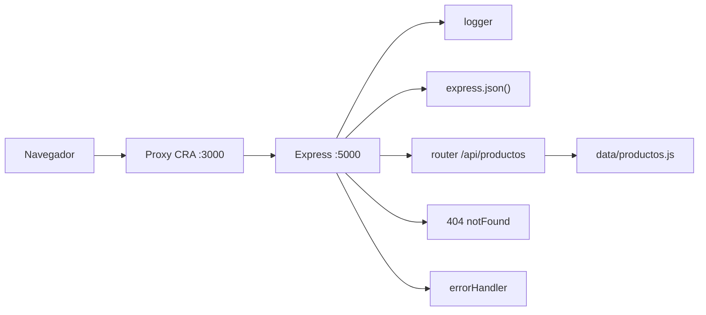

# Mueblería Hermanos Jota — E-commerce (Sprint 3-4)
Aplicación cliente-servidor para la mueblería: React consume una API REST propia.
El backend está hecho con Node.js y Express; el frontend con Create React App.

**Integrante:** Diego Julian Garcia — trabajo individual.
## Instalación y ejecución
Requisitos: Node.js 18 o superior y npm. Usá dos terminales desde la raíz del repo.

**Backend** — http://localhost:5000
```bash
cd backend
npm install
cp .env.example .env
npm run dev
```

**Client** — http://localhost:3000
```bash
cd client
npm install
npm start
```
El client necesita el backend encendido porque usa el proxy de CRA. Si cambiás `PORT` en `backend/.env`, actualizá `"proxy"` en `client/package.json`.
En Windows/PowerShell `cp` funciona; en cmd usá `copy .env.example .env`.
## API

| Método y ruta | Respuesta |
| --- | --- |
| `GET /api/productos` | 200 con los 11 productos |
| `GET /api/productos/:id` | 200 con el producto; 400 si el id es inválido; 404 si no existe |

Ejemplo de campos principales de un producto real:
```json
{
  "id": 1,
  "nombre": "Aparador Uspallata",
  "categoria": "Almacenamiento",
  "precio": 2890000,
  "imagen": "/img/aparador-uspallata.png"
}
```
## Arquitectura

Árbol de carpetas (sin `node_modules` ni `build`):
```
.
├── backend
│   ├── data
│   ├── middlewares
│   └── routes
└── client
    ├── public
    │   └── img
    └── src
        ├── api
        ├── components
        └── utils
```
## Decisiones
- CRA porque lo pide la consigna.
- Datos en `backend/data/productos.js`, sin base de datos.
- Proxy de CRA en lugar de `cors`.
- Vistas y detalle por renderizado condicional con `useState` en `App`; sin router y sin cambios de URL.
- Carrito como estado en `App`, con contador en `Navbar` por props.
- Búsqueda y filtros por categoría resueltos en el cliente.
- Contacto con validación y envío simulado.
## Limitaciones
- El carrito no tiene panel, checkout ni persistencia.
- No hay tests automatizados.
